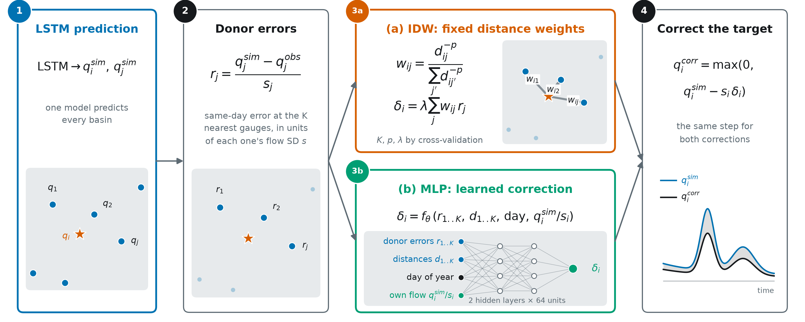
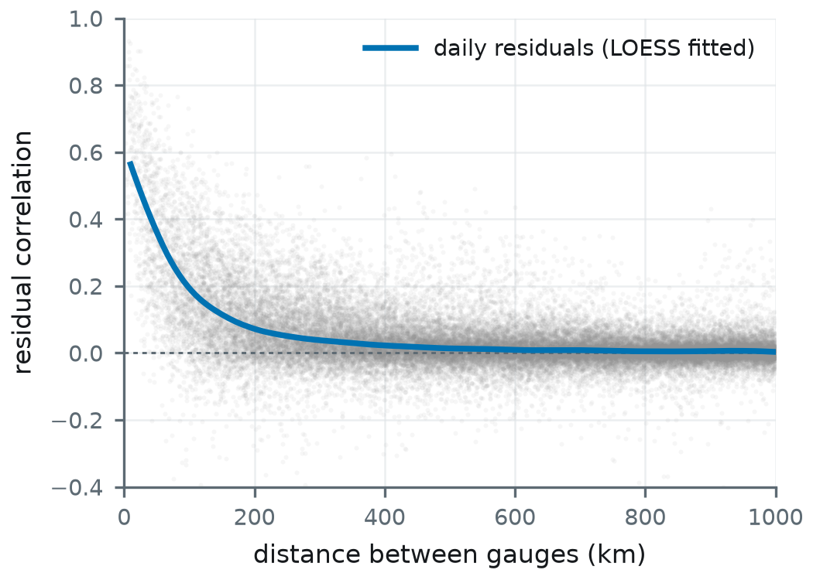
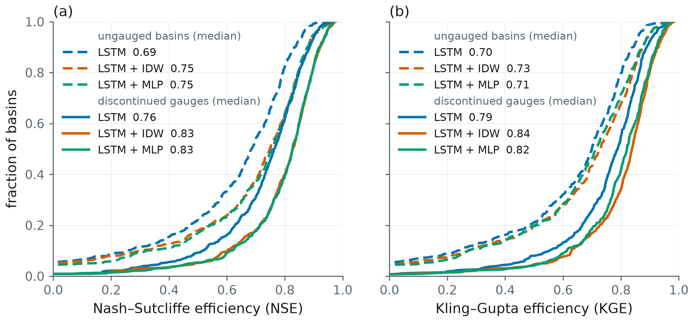
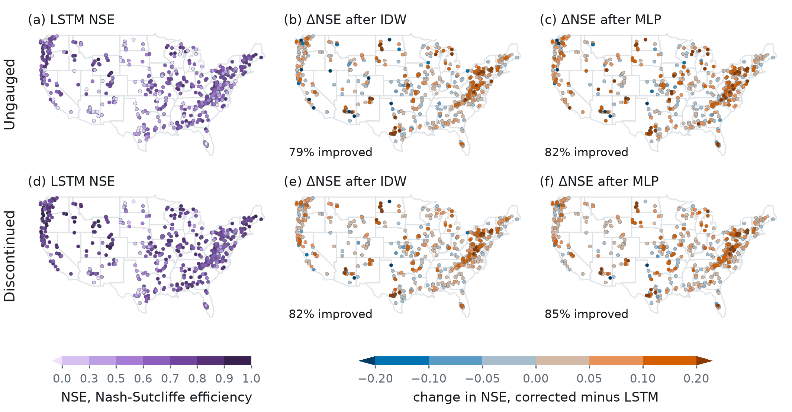
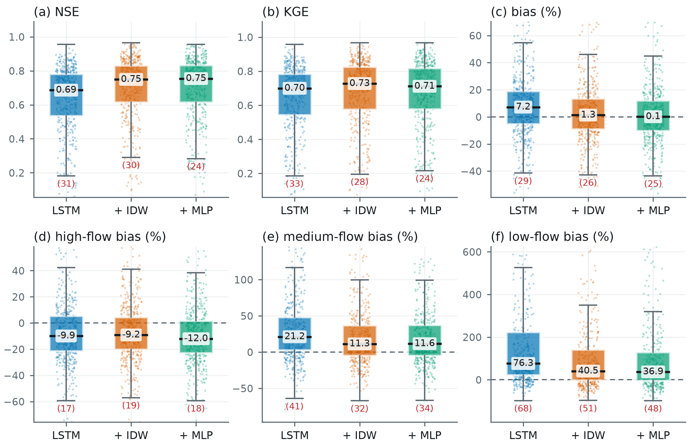
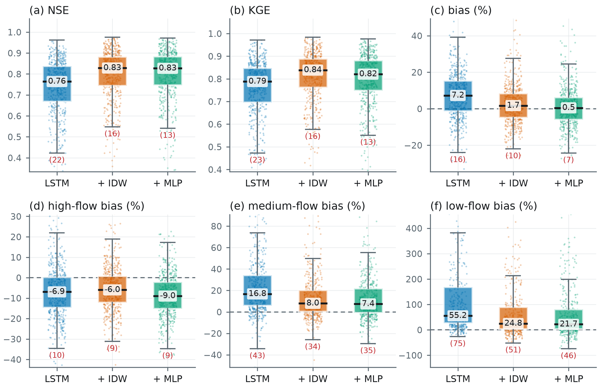
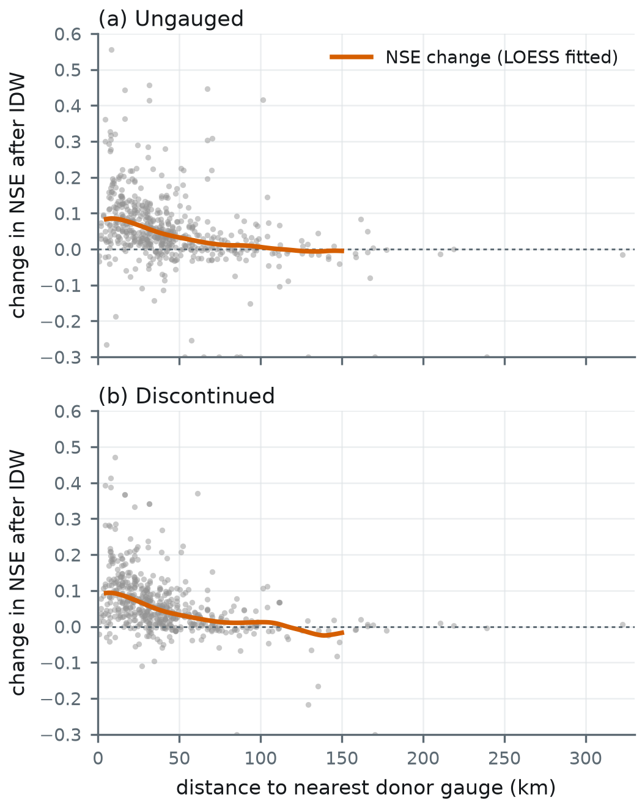

# Technical note: Improving deep-learning streamflow reconstruction with spatial residual correction

Sandeep Poudel1 and Scott Steinschneider2

1Department of Civil and Environmental Engineering, Cornell University, Ithaca, NY 14853, United States
2Department of Biological and Environmental Engineering, Cornell University, Ithaca, NY 14853, United States

Correspondence: Sandeep Poudel (sp2596@cornell.edu)

---

**Short summary.** Many rivers have no streamflow record, or a record that stopped. Deep-learning
models give the best estimates of these missing flows, but their errors are shared by nearby
rivers. We correct a model's estimate at a river without a gauge using the errors it made on the
same day at nearby gauged rivers. This simple step needs no retraining, runs in seconds on any
trained model, and improved estimates at about 80 % of 531 US rivers.

---

## Abstract

Regional deep-learning models are the state of the art for reconstructing daily streamflow at
sites without a gauge. Their errors, however, are not independent between basins: on a given day,
nearby basins tend to be wrong in the same direction. We test whether this shared error can be
removed after the fact, using the errors the model makes on the same day at nearby gauges. The
correction weights the log errors of the nearest gauges by inverse distance and removes a fraction
of their weighted mean from the prediction at the target site. It trains nothing, and its three
parameters are selected by cross-validation that never uses the basins being corrected. Applied
to a regional long short-term memory (LSTM) network across 531 CAMELS-US basins, the correction
raises median Nash–Sutcliffe efficiency from 0.69 to 0.75 at basins never seen in training and
from 0.76 to 0.82 at gauges discontinued after training, improves performance in about 80 % of
basins, and roughly halves low-flow bias. Gains are largest where a gauge lies within about 20 km
and fade with distance. A neural network that learns a day-varying correction from the same
inputs does no better. Spatial residual correction is a simple, low-cost addition to deep-learning
streamflow reconstruction that requires no retraining.

---

## 1 Introduction

Long, continuous records of daily streamflow are needed for water resources management, drought
and flood assessment, and the detection of hydrologic change (Hannah et al., 2011). Yet most river
reaches have never been gauged, and estimating streamflow at these sites remains a long-standing
challenge in hydrology (Sivapalan et al., 2003; Hrachowitz et al., 2013). Many existing records
are also cut short: in the 1990s, more than 100 USGS streamgages with 30 or more years of record
were being discontinued each year (Lanfear and Hirsch, 1999). Both cases call for historical
streamflow reconstruction, that is, estimating past daily flow at a site without its own
observations while nearby gauges did observe. We focus primarily on ungauged basins and treat
discontinued gauges as a second, closely related case.

Regional deep-learning models are now the best available tool for this task. Long short-term
memory (LSTM) networks trained on hundreds of basins outperform calibrated conceptual models, even
at basins held out of training (Kratzert et al., 2019a, b). They now provide operational
predictions in ungauged basins worldwide (Nearing et al., 2024) and underpin historical
reconstruction products at continental and regional scales (Klotz et al., 2026; Gupta et al.,
2026). Giving these models observed streamflow as an input improves them substantially (Feng et
al., 2020; Nearing et al., 2022), but such approaches rely on recent observations at the target
site, which is exactly the information missing in reconstruction. At ungauged or discontinued
sites, the only observed streamflow is at neighboring gauges.

Neighboring gauges have long been the main source of information at unmonitored sites, either by
transferring observed flows (Archfield and Vogel, 2010; Farmer, 2016) or by transferring the
parameters of a model calibrated at nearby basins (Oudin et al., 2008). More recently, Wi et al.
(2025) showed that feeding donor-gauge streamflow into an LSTM improves reconstruction at
ungauged and partially gauged sites. Doing so, however, requires redesigning and retraining the
model. Many users work with deep-learning models that are already trained, often at national or
global scale, and lack the data, computing resources, or access to retrain them. A way to add
information from neighboring gauges without retraining would therefore be of practical value.

One such way is to leave the model unchanged and correct its output using the errors it makes at
nearby gauges. This is promising because model performance is spatially organized: across the
contiguous United States, both conceptual models and LSTMs perform worst in the Great Plains and
the arid southwest (Newman et al., 2015; Feng et al., 2020). For process-based models, the idea
has proven useful. Lachance-Cloutier et al. (2017) combined a regionally calibrated process-based
model with errors observed at nearby gauges to reconstruct daily streamflow at ungauged rivers,
and Matthews et al. (2025) spread errors from gauged to ungauged locations when post-processing
discharge forecasts. Such corrections work only if the model's errors are spatially correlated
(Lachance-Cloutier et al., 2017).

Whether this holds for a regional deep-learning model is not obvious. A regional LSTM is trained
on all basins at once and may already absorb much of the regional component of its error. Yet it
never sees what neighboring gauges recorded on the day it makes a prediction, so errors shared by
nearby basins may remain. To our knowledge, no study has corrected the output of a deep-learning
streamflow model in this way at large sample. Building on the process-based work above, we test a
simple spatial residual correction on a regional LSTM across 531 CAMELS-US basins and ask:

1. Are the daily errors of a regional LSTM spatially structured?
2. Does a spatial residual correction improve reconstruction at ungauged basins and at
   discontinued gauges, and does a more flexible, learned correction do better?
3. Where does the correction help most?

## 2 Data and methods

### 2.1 Data and model

We use the 531 CAMELS-US basins (Newman et al., 2015; Addor et al., 2017) commonly used in
large-sample deep-learning studies, with Daymet meteorological forcings and USGS daily streamflow.
Following Kratzert et al. (2019b), models are trained on water years 1981–1995 and evaluated on
water years 1996–2010. The base model is a regional LSTM with the configuration of Kratzert et al.
(2019a, b), which we do not tune further: a single layer of 256 hidden units with a 365-day input
sequence of six daily forcings and 30 static basin attributes (Table S1). Each model is trained
with five random seeds, and the mean of the five is used as the prediction.

### 2.2 Spatial residual correction

We apply the correction to the finished LSTM predictions in two reconstruction settings:

- **Ungauged basins.** The 531 basins are split into seven random folds. For each fold, an LSTM
  is trained on the other folds (455 basins) and predicts the held-out basins, which are out of
  sample in space and time. The donors for a held-out basin are its fold's training basins.
- **Discontinued gauges.** A single LSTM is trained on all 531 basins, so each basin is out of
  sample in time only, as for a gauge that stopped reporting after training. The donors for a
  basin are the other 530 basins, while its own record is withheld.

The correction needs neighboring gauges that report during the reconstruction period, so it is
evaluated against the same model without correction.

#### 2.2.1 Inverse-distance-weighted correction

On each day, we compute the model's log residual (log predicted minus log observed flow) at the K
nearest donor gauges, combine these residuals with inverse-distance weights (exponent p), and
remove a fraction λ of the weighted residual from the target's log prediction (Fig. 1, steps 1–2,
3a and 4). Working in
log space makes the correction multiplicative and keeps flows non-negative. Donors that did not
report on a given day are dropped and the remaining weights renormalized. The method follows the
idea of Lachance-Cloutier et al. (2017) for process-based models, but uses inverse-distance
weights and a single shrinkage factor, so no error model needs to be fitted. It uses no forcing
data, requires no training, and never reads the target's own streamflow.

The three parameters (K ≤ 39, λ between 0 and 1, and p between 0.5 and 3) are selected by grid
search to maximize the median Kling–Gupta efficiency across a set of search basins, each corrected
from the other search basins. In the ungauged setting, the search basins are the fold's training
basins; in the discontinued setting, the basins keep the same seven groups and the search for each
group uses the other six. The basins being corrected are therefore never used during selection.

#### 2.2.2 Learned correction with an MLP

As a more flexible benchmark, we replace the fixed inverse-distance weights with a multilayer
perceptron (MLP) that predicts the daily log correction directly (Fig. 1, step 3b). Its inputs are the K
nearest donors' log residuals and distances, the day of year, and the target's predicted flow, so
the correction can weight donors freely and vary with season and flow. The MLP has two hidden
layers of 64 units and is trained on the same basins as the inverse-distance search with a 1 − KGE
loss. K is selected on a validation group held back from training, and the mean of five seeds is
used as the corrected prediction.

**Figure 1.** Spatial residual correction for a target basin (star) and its donor gauges (dots).
The LSTM predicts flow at every basin (1), and its same-day log residuals are computed at the K
nearest donor gauges (2). These residuals are turned into a daily log correction δi,
either (3a) as an inverse-distance-weighted mean scaled by λ (IDW) or (3b) by an MLP that also
uses the donors' distances, the day of year, and the target's predicted flow. The correction is
then applied to the target's prediction (4).

### 2.3 Evaluation

We compare the uncorrected LSTM with the inverse-distance-weighted correction (hereafter IDW) and
the MLP correction over the evaluation period at all 531 basins. Performance is measured with the
Nash–Sutcliffe efficiency (NSE; Nash and Sutcliffe, 1970) and the Kling–Gupta efficiency (KGE;
Gupta et al., 2009), together with the overall percent bias and the percent bias for high flows
(top 10 % of observed flows), medium flows (30th–90th percentiles), and low flows (bottom 30 %).
Given the sampling uncertainty of NSE and KGE (Clark et al., 2021), we treat differences in medians
smaller than about 0.01 as ties.

## 3 Results

### 3.1 The daily errors of the LSTM are spatially structured

The daily residuals of the LSTM are strongly correlated between nearby basins (Fig. 2). Residual
correlation is about 0.54 for basins 20 km apart and decreases with distance to about 0.29 at
100 km and 0.10 at 500 km. Even though the LSTM is trained on all basins at once,
a substantial part of its daily error at a site is shared with nearby basins.

**Figure 2.** Correlation of the LSTM's daily log residuals between basin pairs as a function of
the distance between their gauges (discontinued-gauge setting, water years 1996–2010). Gray points
are basin pairs within 1000 km; the line is a LOESS fit.

### 3.2 Spatial residual correction improves reconstruction

The IDW correction improves reconstruction in both settings (Table 1, Fig. 3). Median NSE rises
from 0.69 to 0.75 at ungauged basins and from 0.76 to 0.82 at discontinued gauges, with NSE
improving in about 80 % of basins in each setting; the whole distribution shifts, not only the
median. The correction also removes the overall positive bias of the LSTM and roughly halves
low- and medium-flow biases, while high flows become slightly more underestimated. KGE rises from
0.79 to 0.83 at discontinued gauges but only from 0.70 to 0.71 at ungauged basins: there, the
correction improves correlation and mean bias but slightly reduces flow variability, which offsets
most of the gain. The selected parameters for each fold are listed in Table S2, and distributions
of all metrics are shown in Figs. S1–S2.

The more flexible MLP correction performs no better than IDW. Median NSE and KGE of the two differ
by at most 0.01 in both settings (Table 1, Fig. 3). The MLP reduces low-flow bias somewhat more,
but basin by basin the two corrections are nearly interchangeable: the MLP has the higher NSE in
45 % of ungauged basins and 51 % of discontinued gauges.

**Table 1.** Median performance across 531 basins in the evaluation period (water years 1996–2010).
Biases are percent biases over all days and over days with observed flow in the top 10 % (high),
30th–90th percentiles (medium), and bottom 30 % (low). The last column is the share of basins in
which NSE improves relative to the LSTM.

| Setting | Model | NSE | KGE | Bias (%) | High-flow bias (%) | Medium-flow bias (%) | Low-flow bias (%) | Basins improved (%) |
|---|---|---|---|---|---|---|---|---|
| Ungauged | LSTM | 0.69 | 0.70 | 7.2 | −9.9 | 21.2 | 76.3 | – |
| | LSTM + IDW | 0.75 | 0.71 | −1.6 | −12.9 | 9.5 | 38.0 | 80 |
| | LSTM + MLP | 0.74 | 0.72 | −1.0 | −9.9 | 8.1 | 32.8 | 76 |
| Discontinued | LSTM | 0.76 | 0.79 | 7.2 | −6.9 | 16.8 | 55.2 | – |
| | LSTM + IDW | 0.82 | 0.83 | 0.0 | −8.6 | 6.7 | 28.0 | 79 |
| | LSTM + MLP | 0.82 | 0.83 | 0.1 | −6.2 | 4.8 | 17.6 | 79 |

**Figure 3.** Cumulative distributions of (a) NSE and (b) KGE across the 531 basins for the
uncorrected LSTM and the IDW and MLP corrections, at ungauged basins (dashed) and discontinued
gauges (solid). Medians are given in the legends.

### 3.3 Gains are largest where a gauge is close

The benefit of the correction depends on the distance to the nearest donor gauge (Fig. S3). At
ungauged basins, the median NSE gain is +0.08 for the quarter of basins whose nearest donor lies
within about 20 km and falls to +0.02 for the quarter whose nearest donor is farther than about
60 km; at discontinued gauges it falls from +0.10 to +0.01. Spatially, gains are largest in the
Great Plains, where the uncorrected LSTM performs worst, and in the densely gauged northeast, and
smaller in the Rocky Mountains, the southeast, and along the Pacific coast (Fig. 4).

The correction reduces NSE in about 20 % of basins. These losses are mostly small (median loss
of 0.03), and they occur mainly far from donor gauges: basins that lose performance lie a median
of 57 km from their nearest donor, compared with 32 km for basins that improve, and losses affect
about 40 % of the most distant quarter of basins but only 5 % of the closest.

**Figure 4.** (a, d) NSE of the uncorrected LSTM and the change in NSE after (b, e) the IDW
correction and (c, f) the MLP correction, at ungauged basins (top) and discontinued gauges
(bottom). Orange indicates improvement; the share of basins that improve is given in each panel.

## 4 Discussion

Reconstructing streamflow at sites without a record is important, and regional deep-learning
models are now the best tool for it. However, these models do not use what nearby gauges observed
on the same day. Our results show that a regional LSTM leaves spatially shared daily errors, and
that using these errors after the fact, without retraining, improves reconstruction at both
ungauged basins and discontinued gauges, most strongly where a gauge is close.

The LSTM leaves shared error because it cannot see what nearby gauges recorded on the day it
predicts. Errors in the meteorological forcing are a likely source: a storm that gridded
precipitation misses or misplaces affects every basin it covers on that day. Daymet, which forces
the LSTM here, has known regional precipitation biases (Newman et al., 2015), and gridded products
miss the same storms across a region (Lundquist et al., 2015). Regional processes that static
attributes describe poorly, such as groundwater contributions, can also leave spatially clustered
biases (Feng et al., 2020). Errors of this kind are shared by nearby basins on the same day, which
is what Fig. 2 shows and why the gain from the correction decreases with donor distance.

These results show that even a state-of-the-art deep-learning model can be improved by using the
error pattern at donor gauges. This is consistent with what neighbor errors have done for
process-based models (Lachance-Cloutier et al., 2017; Matthews et al., 2025), where gains were
likewise largest near gauges, and with Wi et al. (2025), who showed that donor gauges improve
deep-learning reconstruction when built into the model; here, the same information helps without
retraining. A simple correction appears to be sufficient: the MLP could weight donors freely and
vary with season and flow, yet did no better, suggesting that little usable signal remains beyond
a distance-weighted average of nearby errors. Averaging several donors and applying only part of
their error also dampens the local noise in each donor's error, such as observation error.

In practice, the correction runs on finished model output in seconds and needs no access to the
training pipeline, which makes it well suited to pretrained models used for reconstruction
(Nearing et al., 2024; Klotz et al., 2026). It is also generic: as deep-learning models for
streamflow prediction continue to improve, the same step can be applied on top of new models. The
approach has three main limitations. First, it requires neighboring gauges that report on the same
days, so it applies to reconstruction but not to forecasting or long-term projections. Second, it
was tested only on CAMELS-US basins, and because the gain depends on how close the donors are,
results may differ in regions with different gauge densities. Third, it reduced performance at
some basins, likely because a full correction is applied even when the donors are far away or
poorly related to the target, so it should be applied with care where gauges are sparse.

## 5 Conclusions

We tested whether the errors of a regional deep-learning model at nearby gauges can improve
streamflow reconstruction at sites without a record. The daily errors of a regional LSTM remain
spatially correlated despite training on all basins at once. A simple, training-free spatial
residual correction raised median NSE by about 0.06 at both ungauged basins and discontinued
gauges, improved about 80 % of basins, and roughly halved low-flow bias, with the largest gains
where a donor gauge is close. A more flexible, learned correction gave no further gain. Spatial
residual correction thus offers a low-cost complement to deep-learning streamflow reconstruction
that can be applied to existing models without retraining.

---

*Code availability.* The code used for all analyses is available at [Zenodo DOI to be added].

*Data availability.* The CAMELS-US dataset is publicly available at
https://doi.org/10.5065/D6MW2F4D (time series) and https://doi.org/10.5065/D6G73C3Q (catchment
attributes).

*Supplement.* The supplement related to this article is available online at [link to be added].
It contains the LSTM inputs (Table S1), the selected correction parameters (Table S2),
distributions of all metrics (Figs. S1–S2), and the NSE gain against donor distance (Fig. S3).

*Author contributions.* S.P. and S.S. conceptualized the project. S.P. developed the code,
conducted the experiments, and prepared the initial draft. S.S. supervised the project and
reviewed and edited the manuscript.

*Competing interests.* The contact author has declared that neither of the authors has any
competing interests.

*Acknowledgements.* [To be added, including a description of any use of AI tools, as required by
HESS.]

*Financial support.* [To be added.]

---

## References

Addor, N., Newman, A. J., Mizukami, N., and Clark, M. P.: The CAMELS data set: catchment
attributes and meteorology for large-sample studies, Hydrol. Earth Syst. Sci., 21, 5293–5313,
https://doi.org/10.5194/hess-21-5293-2017, 2017.

Archfield, S. A. and Vogel, R. M.: Map correlation method: Selection of a reference streamgage to
estimate daily streamflow at ungaged catchments, Water Resour. Res., 46, W10513,
https://doi.org/10.1029/2009WR008481, 2010.

Clark, M. P., Vogel, R. M., Lamontagne, J. R., Mizukami, N., Knoben, W. J. M., Tang, G., Gharari,
S., Freer, J. E., Whitfield, P. H., Shook, K. R., and Papalexiou, S. M.: The abuse of popular
performance metrics in hydrologic modeling, Water Resour. Res., 57, e2020WR029001,
https://doi.org/10.1029/2020WR029001, 2021.

Farmer, W. H.: Ordinary kriging as a tool to estimate historical daily streamflow records, Hydrol.
Earth Syst. Sci., 20, 2721–2735, https://doi.org/10.5194/hess-20-2721-2016, 2016.

Feng, D., Fang, K., and Shen, C.: Enhancing streamflow forecast and extracting insights using
long-short term memory networks with data integration at continental scales, Water Resour. Res.,
56, e2019WR026793, https://doi.org/10.1029/2019WR026793, 2020.

Gupta, H. V., Kling, H., Yilmaz, K. K., and Martinez, G. F.: Decomposition of the mean squared
error and NSE performance criteria: Implications for improving hydrological modelling, J.
Hydrol., 377, 80–91, https://doi.org/10.1016/j.jhydrol.2009.08.003, 2009.

Gupta, R. S., Wi, S., and Steinschneider, S.: Machine learning-based reconstructions of historical
daily and monthly runoff for the Laurentian Great Lakes, Sci. Data, 13, 624,
https://doi.org/10.1038/s41597-026-07000-0, 2026.

Hannah, D. M., Demuth, S., van Lanen, H. A. J., Looser, U., Prudhomme, C., Rees, G., Stahl, K.,
and Tallaksen, L. M.: Large-scale river flow archives: importance, current status and future
needs, Hydrol. Process., 25, 1191–1200, https://doi.org/10.1002/hyp.7794, 2011.

Hrachowitz, M., Savenije, H. H. G., Blöschl, G., et al.: A decade of Predictions in Ungauged
Basins (PUB) — a review, Hydrolog. Sci. J., 58, 1198–1255,
https://doi.org/10.1080/02626667.2013.803183, 2013.

Klotz, D., Miersch, P., do Nascimento, T. V. M., Fenicia, F., Frank, C., Gauch, M., and
Zscheischler, J.: EARLS: a runoff reconstruction dataset for Europe, Earth Syst. Sci. Data, 18,
5485–5504, https://doi.org/10.5194/essd-18-5485-2026, 2026.

Kratzert, F., Klotz, D., Shalev, G., Klambauer, G., Hochreiter, S., and Nearing, G.: Towards
learning universal, regional, and local hydrological behaviors via machine learning applied to
large-sample datasets, Hydrol. Earth Syst. Sci., 23, 5089–5110,
https://doi.org/10.5194/hess-23-5089-2019, 2019a.

Kratzert, F., Klotz, D., Herrnegger, M., Sampson, A. K., Hochreiter, S., and Nearing, G. S.:
Toward improved predictions in ungauged basins: Exploiting the power of machine learning, Water
Resour. Res., 55, 11344–11354, https://doi.org/10.1029/2019WR026065, 2019b.

Lachance-Cloutier, S., Turcotte, R., and Cyr, J.-F.: Combining streamflow observations and
hydrologic simulations for the retrospective estimation of daily streamflow for ungauged rivers in
southern Quebec (Canada), J. Hydrol., 550, 294–306, https://doi.org/10.1016/j.jhydrol.2017.05.011,
2017.

Lanfear, K. J. and Hirsch, R. M.: USGS study reveals a decline in long-record streamgages, Eos
Trans. AGU, 80, 605–607, https://doi.org/10.1029/99EO00406, 1999.

Lundquist, J. D., Hughes, M., Henn, B., Gutmann, E. D., Livneh, B., Dozier, J., and Neiman, P.:
High-elevation precipitation patterns: Using snow measurements to assess daily gridded datasets
across the Sierra Nevada, California, J. Hydrometeorol., 16, 1773–1792,
https://doi.org/10.1175/JHM-D-15-0019.1, 2015.

Matthews, G., Cloke, H. L., Dance, S. L., and Prudhomme, C.: Error-correction across gauged and
ungauged locations: A data assimilation-inspired approach to post-processing river discharge
forecasts, Hydrol. Earth Syst. Sci., 29, 6157–6179, https://doi.org/10.5194/hess-29-6157-2025,
2025.

Nash, J. E. and Sutcliffe, J. V.: River flow forecasting through conceptual models part I — A
discussion of principles, J. Hydrol., 10, 282–290, https://doi.org/10.1016/0022-1694(70)90255-6,
1970.

Nearing, G. S., Klotz, D., Frame, J. M., Gauch, M., Gilon, O., Kratzert, F., Sampson, A. K.,
Shalev, G., and Nevo, S.: Technical note: Data assimilation and autoregression for using
near-real-time streamflow observations in long short-term memory networks, Hydrol. Earth Syst.
Sci., 26, 5493–5513, https://doi.org/10.5194/hess-26-5493-2022, 2022.

Nearing, G., Cohen, D., Dube, V., et al.: Global prediction of extreme floods in ungauged
watersheds, Nature, 627, 559–563, https://doi.org/10.1038/s41586-024-07145-1, 2024.

Newman, A. J., Clark, M. P., Sampson, K., Wood, A., Hay, L. E., Bock, A., Viger, R. J.,
Blodgett, D., Brekke, L., Arnold, J. R., Hopson, T., and Duan, Q.: Development of a large-sample
watershed-scale hydrometeorological data set for the contiguous USA: data set characteristics and
assessment of regional variability in hydrologic model performance, Hydrol. Earth Syst. Sci., 19,
209–223, https://doi.org/10.5194/hess-19-209-2015, 2015.

Oudin, L., Andréassian, V., Perrin, C., Michel, C., and Le Moine, N.: Spatial proximity, physical
similarity, regression and ungaged catchments: A comparison of regionalization approaches based on
913 French catchments, Water Resour. Res., 44, W03413, https://doi.org/10.1029/2007WR006240,
2008.

Sivapalan, M., Takeuchi, K., Franks, S. W., et al.: IAHS Decade on Predictions in Ungauged Basins
(PUB), 2003–2012: Shaping an exciting future for the hydrological sciences, Hydrolog. Sci. J., 48,
857–880, https://doi.org/10.1623/hysj.48.6.857.51421, 2003.

Wi, S., Gupta, R., and Steinschneider, S.: Pooling local climate and donor gauges with deep
learning for improved reconstructions of streamflow in ungauged and partially gauged basins, J.
Hydrol., 661, 133764, https://doi.org/10.1016/j.jhydrol.2025.133764, 2025.

---

# Supplement

## Table S1

**Table S1.** Inputs to the LSTM. Dynamic inputs are daily Daymet forcings; static inputs are
CAMELS-US catchment attributes (Addor et al., 2017), repeated at every time step.

| Category | Name | Description |
|---|---|---|
| Dynamic | dayl | Day length |
| | prcp | Daily total precipitation |
| | srad | Mean shortwave radiation |
| | tmax | Daily maximum temperature |
| | tmin | Daily minimum temperature |
| | vp | Mean vapor pressure |
| Static | p_mean | Mean daily precipitation |
| | pet_mean | Mean daily potential evapotranspiration |
| | aridity | Ratio of mean potential evapotranspiration to mean precipitation |
| | p_seasonality | Seasonality and timing of precipitation |
| | frac_snow | Fraction of precipitation falling as snow |
| | high_prec_freq | Frequency of high-precipitation days |
| | high_prec_dur | Average duration of high-precipitation events |
| | low_prec_freq | Frequency of dry days |
| | low_prec_dur | Average duration of dry periods |
| | elev_mean | Mean elevation of the basin |
| | slope_mean | Mean slope of the basin |
| | area_gages2 | Basin area (GAGES-II) |
| | frac_forest | Fraction of forest |
| | lai_max | Maximum monthly mean leaf area index |
| | lai_diff | Difference between maximum and minimum monthly mean leaf area index |
| | gvf_max | Maximum monthly mean green vegetation fraction |
| | gvf_diff | Difference between maximum and minimum monthly mean green vegetation fraction |
| | dom_land_cover_frac | Fraction of the basin covered by the dominant land cover |
| | soil_depth_pelletier | Depth to bedrock |
| | soil_depth_statsgo | Soil depth |
| | soil_porosity | Volumetric soil porosity |
| | soil_conductivity | Saturated hydraulic conductivity |
| | max_water_content | Maximum water content of the soil |
| | sand_frac | Fraction of sand |
| | silt_frac | Fraction of silt |
| | clay_frac | Fraction of clay |
| | glim_1st_class_frac | Fraction of the basin in the most common geologic class |
| | glim_2nd_class_frac | Fraction of the basin in the second most common geologic class |
| | carbonate_rocks_frac | Fraction of the basin underlain by carbonate sedimentary rocks |
| | geol_permeability | Subsurface permeability |

## Table S2

**Table S2.** Correction parameters selected for each of the seven folds (ungauged basins) or
groups (discontinued gauges): the number of donors K, the shrinkage λ, and the distance exponent p
of the IDW correction, and the number of donors K of the MLP correction.

| Setting | Fold | IDW K | IDW λ | IDW p | MLP K |
|---|---|---|---|---|---|
| Ungauged | 1 | 25 | 0.55 | 3.0 | 15 |
| | 2 | 3 | 0.70 | 1.5 | 5 |
| | 3 | 7 | 0.80 | 2.5 | 20 |
| | 4 | 9 | 0.60 | 2.0 | 10 |
| | 5 | 5 | 0.50 | 3.0 | 10 |
| | 6 | 3 | 0.50 | 0.5 | 5 |
| | 7 | 21 | 0.45 | 3.0 | 3 |
| Discontinued | 1 | 3 | 0.45 | 3.0 | 3 |
| | 2 | 3 | 0.70 | 3.0 | 10 |
| | 3 | 3 | 0.75 | 2.5 | 20 |
| | 4 | 21 | 0.45 | 3.0 | 5 |
| | 5 | 3 | 0.70 | 2.5 | 20 |
| | 6 | 3 | 0.55 | 0.5 | 15 |
| | 7 | 3 | 0.50 | 1.5 | 20 |

## Figure S1

**Figure S1.** Distributions across the 531 ungauged basins of (a) NSE, (b) KGE, (c) overall
bias, and (d–f) high-, medium-, and low-flow bias for the uncorrected LSTM and the IDW and MLP
corrections. Boxes show the interquartile range with the median labeled; whiskers extend to 1.5
times the interquartile range. Points are individual basins, and red numbers give the number of
basins outside the plotted range.

## Figure S2

**Figure S2.** As Fig. S1, for discontinued gauges.

## Figure S3

**Figure S3.** Change in NSE after the IDW correction against the distance to the nearest donor
gauge, at (a) ungauged basins and (b) discontinued gauges. Each dot is a basin; the black line
joins the median change in each quarter of basins sorted by distance, and the rank correlation
between change and distance is given in each panel. Values beyond the vertical axis limits are
drawn at the limits.
